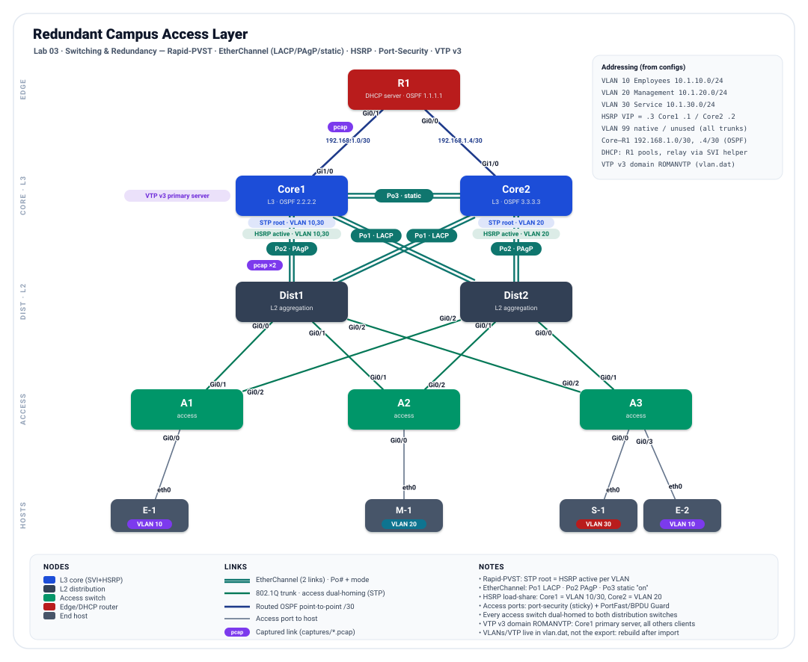

# Incident 03-t2-s7011: Redundant Campus Access Layer


## Incident Report

| Reported | Tier | Ticket voice |
|----------|------|--------------|
| 2026-10-12 17:35 | T2 Standard | the user's view, no device named |

> Monitoring shows VLAN 30 traffic leaving through a different first hop than the design.

## Lab Overview

**Lab:** [03 Redundant Campus Access Layer](../../../03-switching-redundancy/README.md). The lab README is the design: when a device disagrees with it, the README wins.

This lab builds a **redundant, dual-homed campus** and proves it stays up when a link or a switch fails. Three access switches each home to **both** distribution switches; the distribution pair aggregates to a **redundant L3 core** where every VLAN's default gateway is an **HSRP** virtual IP, and every inter-switch connection is an **EtherChannel**. The design goal is that a host keeps its gateway, its uplink, and its path to the DHCP server through any single failure. It proves four Layer-2/redundancy competencies working together — Rapid-PVST with a deterministic, load-shared root; EtherChannel in all three negotiation modes; HSRP active/standby load-sharing; and access-port security — over an OSPF underlay with centralized DHCP. The VLAN database itself is distributed from Core1 with **VTP version 3**.

<p align="center">
  
</p>

### Node Inventory

| Node | Role | Type | `node_definition` |
|------|------|------|-------------------|
| Core1 | L3 core — SVIs, HSRP active VLAN 10/30, STP root VLAN 10/30, VTP v3 primary server (RID 2.2.2.2) | Multilayer switch | `iosvl2` |
| Core2 | L3 core — SVIs, HSRP active VLAN 20, STP root VLAN 20, VTP client (RID 3.3.3.3) | Multilayer switch | `iosvl2` |
| Dist1 | L2 distribution / aggregation (`no ip routing`), VTP client | Switch | `iosvl2` |
| Dist2 | L2 distribution / aggregation (`no ip routing`), VTP client | Switch | `iosvl2` |
| A1 | Access switch — VLAN 10 (Employees), VTP client | Switch | `iosvl2` |
| A2 | Access switch — VLAN 20 (Management), VTP client | Switch | `iosvl2` |
| A3 | Access switch — VLAN 30 (Service) + VLAN 10 (Employees) (`no ip routing`), VTP client | Switch | `iosvl2` |
| R1 | Edge router — central DHCP server + OSPF (RID 1.1.1.1) | Router | `iosv` |
| E-1 | End host, VLAN 10 (Employees) — on A1 | Desktop | `desktop` |
| M-1 | End host, VLAN 20 (Management) — on A2 | Desktop | `desktop` |
| S-1 | End host, VLAN 30 (Service) — on A3 | Desktop | `desktop` |
| E-2 | End host, VLAN 10 (Employees) — on A3 | Desktop | `desktop` |

## Scope & Rules

- Fix the problem on the devices from their consoles in CML. No wipes, re-imports, node restarts or cabling changes.
- Save every fix with `write memory`. A fix that is not saved grades **Temporary**.
- Fix the cause, not the symptom. A workaround that makes traffic flow (a static route, a borrowed address, a shut peer) grades **Temporary**.
- Keep the design. A fix that works but changes the design intent (STP roots, active gateways, OSPF areas) grades **Off-design**.
- Leave everything else as you found it. Each baseline check that passed at the start and fails at grading costs 15 points.
- The grader restarts the affected hosts so they ask DHCP again before it tests them.
- Hints unlock in order and cost points; they are logged with a timestamp. T2 Standard allows up to h3.
- Time from `start` to `grade` is recorded, not scored.

| Hints taken | Penalty added | Total penalty |
|-------------|---------------|---------------|
| h1 | 10 | 10 |
| h1 + h2 | 20 | 30 |
| h1 + h2 + h3 | 35 | 65 |

## Known Good

What fixed looks like. Every check below passed live on a healthy import of this lab (run `03-healthy-1735`, 39/39). The grader reruns the same checks after grading.

| Check | Where | Healthy result | Verify with |
|-------|-------|----------------|-------------|
| Spanning-tree root | Core1, Core2 | VLAN 10, VLAN 30: Core1 is root; VLAN 20: Core2 is root | `show spanning-tree vlan <vlan>` |
| HSRP active gateway | Core1, Core2 | VLAN 10: Core1 Vlan10 is Active; VLAN 20: Core2 Vlan20 is Active; VLAN 30: Core1 Vlan30 is Active | `show standby brief` |
| OSPF neighbors | R1, Core1, Core2 | R1: 2 FULL of 2 (expected 2); Core1, Core2: 4 FULL of 4 (expected 4) | `show ip ospf neighbor` |
| EtherChannel bundles | Core1, Core2, Dist1, Dist2 | Core1 Po1, Core2 Po1, Dist1 Po1, Dist2 Po1: Po1 up, lacp, 2 members; Core1 Po2, Core2 Po2, Dist1 Po2, Dist2 Po2: Po2 up, pagp, 2 members; Core1 Po3, Core2 Po3: Po3 up, on, 2 members | `show etherchannel summary` |
| VTP | Core1, Core2, Dist1, Dist2, A1, A2, A3 | Core1: v3 ROMANVTP primary server; Core2, Dist1, Dist2, A1, A2, A3: v3 ROMANVTP client | `show vtp status` |
| VLANs | A1, A2, A3, Dist1, Dist2, Core2, Core1 | A1, A2, A3, Dist1, Dist2, Core2, Core1: all active | `show vlan brief` |
| Port security | A1, A2, A3 | A1 GigabitEthernet0/0, A2 GigabitEthernet0/0, A3 GigabitEthernet0/0, A3 GigabitEthernet0/3: Secure-up, 1 sticky | `show port-security interface <port>` |
| DHCP bindings | R1 | R1: 4 bindings (need 4) | `show ip dhcp binding` |
| Reachability | R1 | from R1: 4/4 reachable | `ping <address>` |

## Getting Started

Run from Ubuntu (WSL1) with the `breaker` venv active, in `troubleshooting/`.

```text
python -m breaker start 03-t2-s7011                # import, boot, rebuild; the clock starts
python -m breaker hint 03-t2-s7011 <fault#>        # next hint for one fault: h1, then h2, then h3
python -m breaker grade 03-t2-s7011                # grade live; run it again after more fixes
python -m breaker debrief 03-t2-s7011              # reveal the answers, write debrief.md
python -m breaker clean --id 03-t2-s7011 --remove  # stop, wipe and delete the incident lab
```
