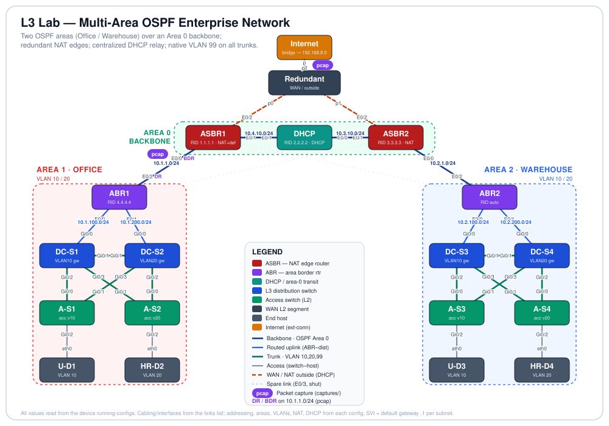

# Incident 02-t2-s7060: Multi-Area OSPF Enterprise Campus


## Incident Report

| Reported | Tier | Ticket voice |
|----------|------|--------------|
| 2026-10-25 21:58 | T2 Standard | the user's view, no device named |

> Nobody on the VLAN 10 floor can get on the network this morning.

## Lab Overview

**Lab:** [02 Multi-Area OSPF Enterprise Campus](../../../02-multi-area-ospf-campus/README.md). The lab README is the design: when a device disagrees with it, the README wins.

This lab is a full two-site enterprise network. An **Office** site and a **Warehouse** site each carry two user VLANs behind a Layer-3 distribution layer, and the two sites are joined by a multi-area OSPF core with a **redundant, NAT-based Internet edge** and **centralized DHCP** delivered by relay. It proves that a client in any site VLAN can lease an address from a central server several routed hops away, reach the other site across the OSPF backbone, and reach the Internet through a translated edge. Every device in the lab is configured and forwarding.

<p align="center">
  
</p>

### Node Inventory

| Node | Role | Type | `node_definition` |
|------|------|------|-------------------|
| Internet | Internet edge (bridged to `192.168.8.0`) | External connector | `external_connector` |
| Redundant | WAN / outside L2 segment (both ASBRs + Internet) | Unmanaged switch | `unmanaged_switch` |
| ASBR1 | NAT edge router + default originator (RID 1.1.1.1) | Router | `iol-xe` |
| ASBR2 | NAT edge router, redundant egress (RID 3.3.3.3) | Router | `iol-xe` |
| DHCP | Central DHCP server + Area 0 transit (RID 2.2.2.2) | Router | `iol-xe` |
| ABR1 | Area Border Router, Area 0 ↔ Area 1 / Office (RID 4.4.4.4) | Router | `iol-xe` |
| ABR2 | Area Border Router, Area 0 ↔ Area 2 / Warehouse | Router | `iol-xe` |
| DC-S1 | Office L3 distribution — VLAN 10 gateway | Multilayer switch | `iosvl2` |
| DC-S2 | Office L3 distribution — VLAN 20 gateway | Multilayer switch | `iosvl2` |
| DC-S3 | Warehouse L3 distribution — VLAN 10 gateway | Multilayer switch | `iosvl2` |
| DC-S4 | Warehouse L3 distribution — VLAN 20 gateway | Multilayer switch | `iosvl2` |
| A-S1 | Office access switch (U-D1, VLAN 10) | Switch | `iosvl2` |
| A-S2 | Office access switch (HR-D2, VLAN 20) | Switch | `iosvl2` |
| A-S3 | Warehouse access switch (U-D3, VLAN 10) | Switch | `iosvl2` |
| A-S4 | Warehouse access switch (HR-D4, VLAN 20) | Switch | `iosvl2` |
| U-D1 | Office end host (VLAN 10) | Desktop | `desktop` |
| HR-D2 | Office end host (VLAN 20) | Desktop | `desktop` |
| U-D3 | Warehouse end host (VLAN 10) | Desktop | `desktop` |
| HR-D4 | Warehouse end host (VLAN 20) | Desktop | `desktop` |

## Scope & Rules

- Fix the problem on the devices from their consoles in CML. No wipes, re-imports, node restarts or cabling changes.
- Save every fix with `write memory`. A fix that is not saved grades **Temporary**.
- Fix the cause, not the symptom. A workaround that makes traffic flow (a static route, a borrowed address, a shut peer) grades **Temporary**.
- Keep the design. A fix that works but changes the design intent (STP roots, active gateways, OSPF areas) grades **Off-design**.
- Leave everything else as you found it. Each baseline check that passed at the start and fails at grading costs 15 points.
- The grader restarts the affected hosts so they ask DHCP again before it tests them.
- Hints unlock in order and cost points; they are logged with a timestamp. T2 Standard allows up to h3.
- Time from `start` to `grade` is recorded, not scored.

| Hints taken | Penalty added | Total penalty |
|-------------|---------------|---------------|
| h1 | 10 | 10 |
| h1 + h2 | 20 | 30 |
| h1 + h2 + h3 | 35 | 65 |

## Known Good

What fixed looks like. Every check below passed live on a healthy import of this lab (run `02-healthy-2028`, 28/28). The grader reruns the same checks after grading.

| Check | Where | Healthy result | Verify with |
|-------|-------|----------------|-------------|
| OSPF neighbors | DHCP , ASBR1, ASBR2, ABR1, ABR2, DC-S1, DC-S2, DC-S3, DC-S4 | DHCP, ASBR1, ASBR2: 2 FULL of 2 (expected 2); ABR1, ABR2: 3 FULL of 3 (expected 3); DC-S1, DC-S2, DC-S3, DC-S4: 1 FULL of 1 (expected 1) | `show ip ospf neighbor` |
| Preferred paths | DHCP | DHCP  0.0.0.0: via 10.4.10.1 AD 110 (optional) | `show ip route <prefix>` |
| VLANs | DC-S1, DC-S2, DC-S3, DC-S4, A-S1, A-S2, A-S3, A-S4 | DC-S1, DC-S2, DC-S3, DC-S4, A-S1, A-S2, A-S3, A-S4: all active | `show vlan brief` |
| Trunks | DC-S1, DC-S2, DC-S3, DC-S4, A-S1, A-S2, A-S3, A-S4 | DC-S1, DC-S2, DC-S3, DC-S4: 3 trunks as configured; A-S1, A-S2, A-S3, A-S4: 2 trunks as configured | `show interfaces trunk` |
| DHCP bindings | DHCP | DHCP: 4 bindings (need 4) | `show ip dhcp binding` |
| Reachability | ABR1, ABR2 | from ABR1, from ABR2: 4/4 reachable | `ping <address>` |

## Getting Started

Run from Ubuntu (WSL1) with the `breaker` venv active, in `troubleshooting/`.

```text
python -m breaker start 02-t2-s7060                # import, boot, rebuild; the clock starts
python -m breaker hint 02-t2-s7060 <fault#>        # next hint for one fault: h1, then h2, then h3
python -m breaker grade 02-t2-s7060                # grade live; run it again after more fixes
python -m breaker debrief 02-t2-s7060              # reveal the answers, write debrief.md
python -m breaker clean --id 02-t2-s7060 --remove  # stop, wipe and delete the incident lab
```
